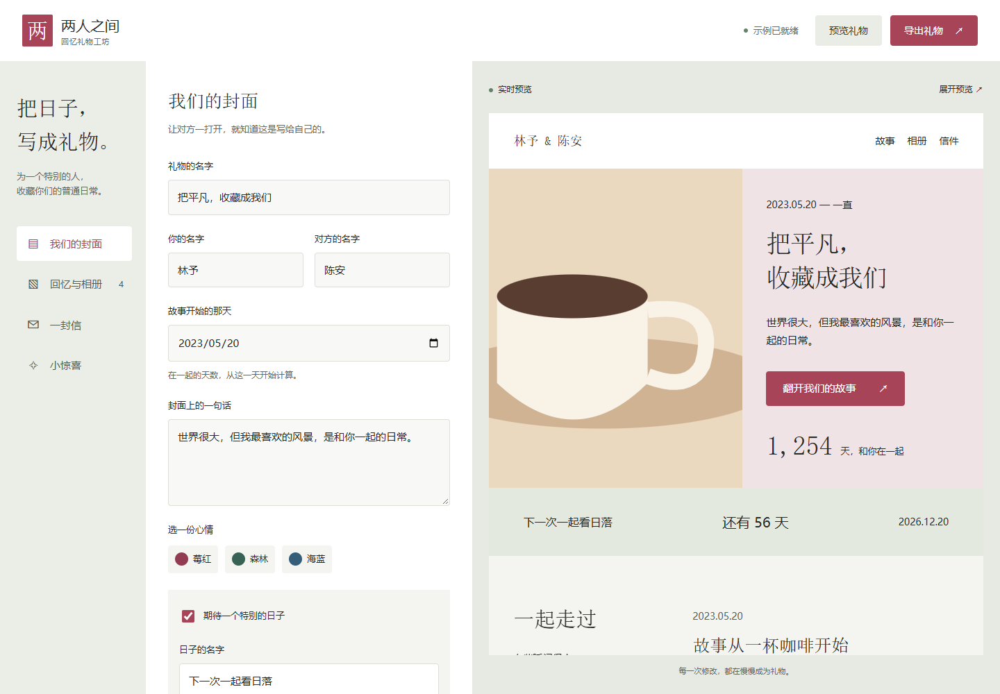

# Surprises for Couples · 把我们的故事做成一份礼物

[English](README.md)

把共同的回忆整理成个人网站、可以断网打开的纪念馆，以及长期可读的 Markdown 文件。

这是一个中文界面的本地优先静态应用。可以从虚构示例开始，也可以新建空白项目；写故事、放入照片和音视频，再导出送给对方。不需要账号、后端或 AI API。Codex 和 Claude 只用于可选的源码定制。



[桌面收礼预览](docs/screenshots/recipient-desktop.png) · [手机收礼预览](docs/screenshots/recipient-mobile.png)

## 本地运行

准备 Node.js 22.12+ 或更新的受支持 LTS 版本、npm 和新版桌面浏览器。

```sh
git clone https://github.com/wenshanvincent-creator/surprises-for-couples.git
cd surprises-for-couples
npm ci
npm run dev
```

打开 Vite 输出的本地地址。以后回到同一浏览器、同一地址，才能继续读取该位置保存的项目。

## 制作礼物

1. 浏览虚构示例，或从空白项目开始。
2. 填写名字、开始日期、献词、长信和可选的下次纪念日。
3. 添加有日期的回忆，附上照片、音频或视频，调整顺序。
4. 预览收礼人的页面，试用小惊喜。
5. 先下载一份可编辑备份，再导出离线纪念馆送给对方。

| 导出内容 | 用途 | 打开方式 |
| --- | --- | --- |
| 可编辑备份 ZIP | 换设备、恢复项目，保留媒体 | 在编辑器中导入 |
| 离线纪念馆 ZIP | 交付完整的收礼页面 | 完整解压，打开 `index.html` |
| Markdown 回忆库 ZIP | 用普通文件保存文字与原始媒体 | 解压后用文本或 Markdown 编辑器阅读 |

编辑器的网址不包含你的回忆；分享成品需要发送导出的纪念馆。浏览器数据可能被清除，请另外保存备份。导出文件包含个人内容且没有加密；部署到公开网站后，其他人也可能访问。

## 使用指南

- [开始制作](docs/getting-started.md)
- [备份、离线礼物与 Markdown](docs/portability.md)
- [可选部署](docs/deployment.md)
- [用 Codex 或 Claude 定制](docs/ai-workflows.md)
- [参与贡献](CONTRIBUTING.md) · [安全与隐私](SECURITY.md)
- [依赖与示例素材许可](THIRD_PARTY_NOTICES.md)

## 开发与验证

```sh
npm run typecheck
npm run build
npm test
npx playwright install chromium
npm run test:e2e
```

浏览器测试使用生产构建，先运行 `npm run build`。也可以设置 `PLAYWRIGHT_CHANNEL=chrome` 使用系统 Chrome；Windows 命令和测试范围见[贡献指南](CONTRIBUTING.md)。

GitHub Actions 检查代码和关键浏览器旅程。Pages 工作流需要手动触发，放入仓库本身不会自动公开部署。当前版本只有一套主题，产品界面为中文；账号、云同步、消息平台接入和 AI 推理不在本版范围内。

## 许可

原创代码、文档和原创虚构示例素材采用 [MIT 许可](LICENSE)。你上传的回忆和媒体仍归你或原权利人所有；上传文件不代表拥有公开传播授权。第三方依赖保留各自许可。
